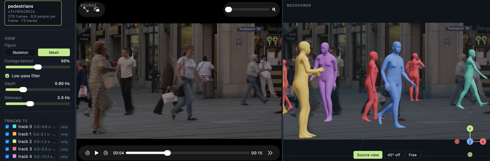
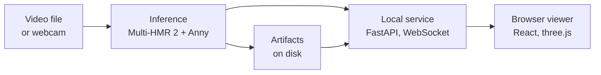

# Unproject

**Multi-person 3D reconstruction and visualization from monocular video, running
entirely on consumer hardware.**



Unproject takes an ordinary video or a webcam stream, finds every person in it
and recovers their 3D pose, body shape and position relative to the camera. The
result is shown in the browser beside the source footage, and can be inspected
from any viewpoint.

It is the practical component of my bachelor's thesis in Computer Engineering at
the University of Modena and Reggio Emilia (2026).

## Why

- **Privacy.** The frames show recognisable people. Sending them to a remote
  service hands them to a third party, so every frame is processed on the
  machine that captured it.
- **Consumer hardware.** Local processing only matters if it fits on the
  machines people actually own: laptops and consumer graphics cards.
- **Monocular ambiguity.** A small person close to the camera and a tall one
  far away look the same in an image, so distance can only be *estimated*. The
  project measures how good that estimate is, rather than assuming it.

## Results

Measured on seven machines - two Apple Silicon MacBook Pros (M3 Pro, M4 Pro)
and five NVIDIA GeForce cards (RTX 3060, 4070, 4090, 5070, 5090) - on MOT16,
MuPoTS-3D and a public pedestrian clip.

- **Feasibility.** Local processing runs on all seven machines: 0.07-0.50 s
  median inference per 1920×1080 frame, with at most 5.0 GB of process memory.
  None reaches real time (30 fps), but with its GPU every machine stays within
  the one-second budget of interactive streaming. Surprisingly, the RTX 4090
  and 5090 were slower than the 4070 and 5070; the likely cause is their
  server CPUs.
- **Cost.** Latency depends on the frame's aspect ratio (a square frame costs
  up to 1.7× more), the number of people and the output type (a full mesh adds
  2-18 %) - but not on the video resolution, since the model always sees the
  frame resized.
- **Accuracy.** On MuPoTS-3D the mean joint error is 141 mm once each body is
  centred, and 352 mm in camera space (284 mm with the true camera
  parameters). The error is concentrated in depth, which is underestimated
  even when the camera is known.
- **Stability.** The estimated distance jitters from frame to frame; the
  viewer's temporal filter reduces it by 87.5 %, at the cost of a lag that
  grows with distance.

The full methodology and every number are in the thesis; the protocols are in
[`docs/experiments/`](docs/experiments/).

## How it works



- **Inference.** [Multi-HMR 2](https://github.com/naver/multi-hmr2), a pretrained
  network, detects every person in one forward pass and estimates their pose,
  body proportions and distance from the camera. The
  [Anny](https://github.com/naver/anny) body model turns those parameters into a
  skeleton and a mesh, in metres. No model was trained or fine-tuned.
- **Artifacts.** Every run is stored as typed, content-addressed files, so a
  result can be traced back to the exact input, configuration and weights.
- **Service and viewer.** A local FastAPI service serves finished runs and
  streams new estimates over a WebSocket; the React/three.js viewer draws them
  as skeletons or meshes, from the camera's viewpoint, 45° off it, or freely.

More detail in [`docs/architecture.md`](docs/architecture.md).

## Quick start

Requirements: [uv](https://docs.astral.sh/uv/) and [pnpm](https://pnpm.io/).
Runs on Apple Silicon (Metal), on Linux with an NVIDIA GPU (CUDA), or - slowly -
on the CPU.

```shell
git clone https://github.com/Laura-Ted/unproject-thesis.git && cd unproject-thesis
uv sync --extra multihmr      # Python 3.12 and the dependencies
pnpm install
uv run unproject-api
```

Open **http://localhost:8000**, then press **Open a video** or **Use the camera**.
The first run downloads the Multi-HMR 2 weights (1.6 GB) and checks their
checksum. Nothing else leaves the machine.

## Licence

The code is released under the [MIT licence](LICENSE). It does not cover what the
code downloads or reads: the Multi-HMR 2 weights are CC BY-NC-SA 4.0, and each
dataset keeps its own terms ([`docs/datasets.md`](docs/datasets.md)).
