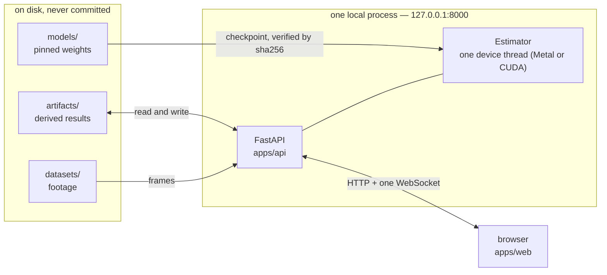
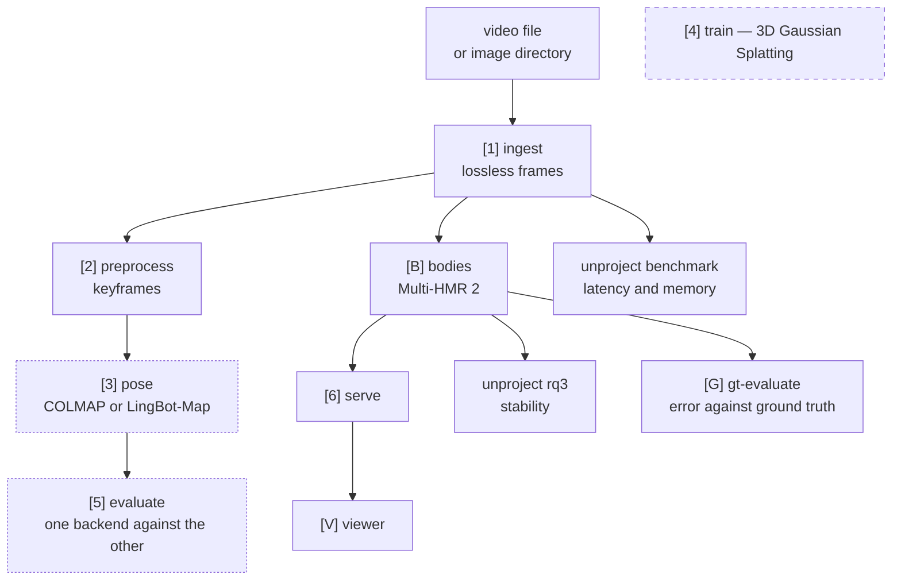
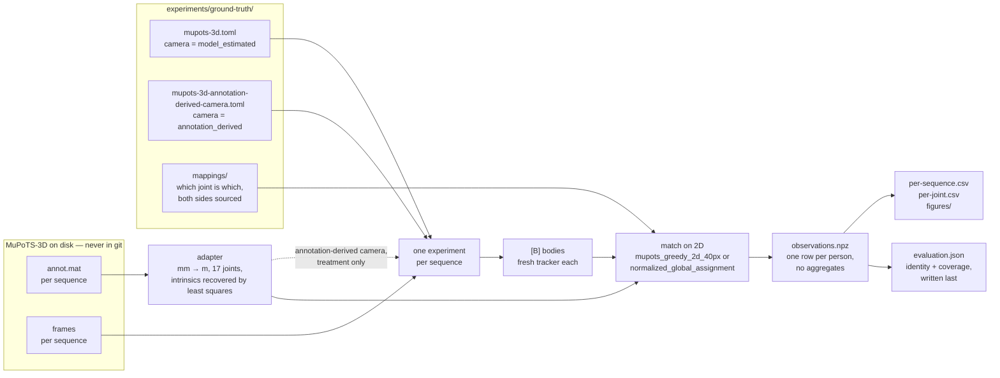
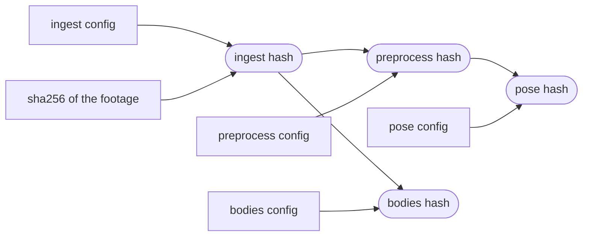
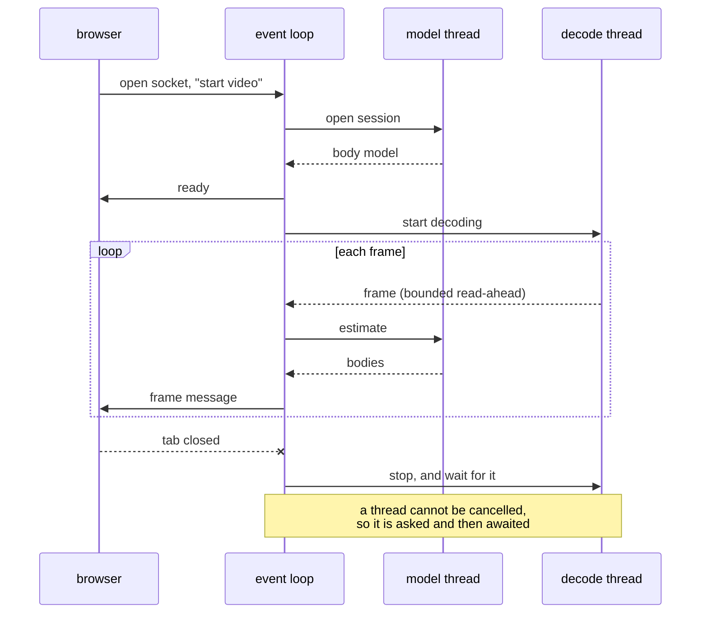

# Architecture

One local process owns the model and serves the viewer; the browser is a client.
Nothing leaves the machine.

## The pipeline

Stages are independent and resumable. Each reads the artifact of the one before
and writes its own; a stage is skipped when a complete artifact with the same
identity is already there.

Dashed: **[4]** is deferred by ADR-0002 and not implemented. **[3]** and **[5]**
are preliminary work — they run, and they are what showed that a near-static
camera over a moving crowd gives Structure-from-Motion nothing to triangulate.
Body capture is the thesis path.

Stage **[B]** reads **[1]** directly rather than **[2]**: keyframe selection
discards frames for being similar to the last one, which is exactly the frames
motion needs.

## The ground-truth evaluation

**[G]** is where the depth claim is measured. It reaches **[B]** through the
ordinary experiment path rather than a second copy of it: each dataset sequence
becomes an experiment whose ingest source is that sequence's frame directory,
so the estimator - and with it the tracker - is built fresh per sequence and
nothing crosses a sequence boundary.

Two things the shape enforces. Association uses the released 2D joints and the
model's own projection, never the 3D that the metrics then claim to measure; a
match chosen by 3D proximity would encode the answer into the pairing. And the
observations file holds no aggregate: every table and figure is a view of it,
regenerated byte for byte, so a number in the thesis cannot disagree with the
file beside it.

The identity of an evaluation is the hash of its config, the annotation files,
the joint mapping and the sequence list. The matcher, the camera source and the
metric protocol are config fields, not flags, because two runs that paired
people differently or told the model different cameras are two measurements
and must not share a directory. That was a bug once. Every value is named by
what it is - `mupots_greedy_2d_40px`, `annotation_derived`,
`unproject_mupots_14j_v1` - because the words *official* and *released* were
once used for things this project does not have (ADR-0005 §3): the result is
the Unproject protocol on MuPoTS-3D, a MuPoTS-compatible project metric, and
the second camera is recovered from annotations, not published.

## Where identity comes from

An artifact is addressed by everything that went into it. Change any of it and
the run lands somewhere else rather than overwriting what was there.

The footage digest is in there because a path is not an identity: two different
videos can sit at `datasets/crowd/clip.mp4`, and without the digest the second
would be served the first one's frames. See ADR-0002 §7.2.

## Concurrency, and why it is shaped this way

Everything that touches the model runs on **one** dedicated thread. Metal keeps a
command buffer per thread and aborts the process when work arrives on a second
one — which is not a hypothetical, it happened.

Two live sessions may be open and take turns on that thread. A third is refused
with a message rather than joining a queue whose end it cannot see.

## What is deliberately absent

No database, no message broker, no second backend service, no cloud component.
The supported deployment is loopback-only and has no authentication: binding it
to a network interface would expose artifacts, uploaded footage and inference to
anyone who can reach the port.
